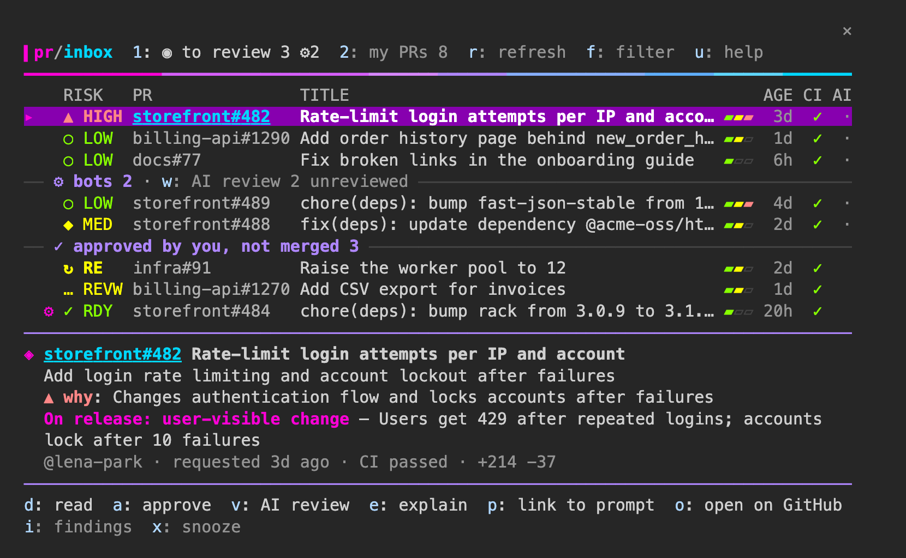

# pr-inbox

A Claude Code mod that turns your review requests and your own pull requests into an inbox, ordered by what needs you next: AI summary and risk, an AI review that can approve, a reader for the description and the diff, merging (stacks included), and CI fixes with Claude.



- **To review**: review requests, the longest-waiting first, then bots' under their own heading, then the PRs you approved that are not merged yet. Each request gets an AI summary, a risk level and its impact on release
- **My PRs**: what needs you (changes requested, CI failed, conflict), then what is ready to merge, what is in review, and what has gone quiet
- **Issues**: the open issues assigned to you (up to 50), the most recently updated first, with their labels, sub-issues closed of all (`SUB`), comment count (`TALK`) and time since the last update (`UPD`). A sub-issue sits under its parent when you have both (`├` `└`), and names its parent otherwise (`↑#12`). An issue updated since you last selected it is marked `●`. The selected issue's description, sub-issues, linked PRs (those that close it, then those that mention it) and latest three comments show under the list; `d` reads it whole (every comment, the latest 100), `p` puts its link in the prompt to ask Claude about it (read-only unless you allow edits) and `c` closes or reopens it. Nothing the tab fetches is sent to a model unless you ask with `p` (an issue a PR's description links to is read by the AI review, `v`, on its own; see [Security](#security))
- A status line under the prompt keeps the counts in view, and new review requests come as a toast and an OS notification (a newly assigned issue as a toast, and an OS notification with `desktop_notify` on `all`)

Tested with Claude Code v2.1.289. Mods need v2.1.287 or later.

## Requirements

- [GitHub CLI](https://cli.github.com/), signed in with `gh auth login`. The mod reads, approves and merges through `gh`, as the account it is signed in to
- Optional: [gh stack](https://github.com/github/gh-stack) (`gh extension install github/gh-stack`) to merge stacked PRs, and [ghq](https://github.com/x-motemen/ghq) so `c` can find (or fetch) your clone of a repository

## Install

In Claude Code:

```
/plugin marketplace add 2bo/pr-inbox
/plugin install pr-inbox@pr-inbox
```

Or from the shell: `claude plugin marketplace add 2bo/pr-inbox && claude plugin install pr-inbox@pr-inbox`.

## First run

1. **Before anything else**: by default each review request is analyzed as soon as Claude Code starts, which sends its title, description and diff to the model you use (see [What is sent](#security)). For work code, set `analysis` to `when opened` or `off`, or narrow it with `org_filter`, first (`/config`)
2. The status line appears under the prompt: `to review 3 ⚙2 · ▲1 high │ my PRs ✗1 fix · ✓1 ready · …2 in review │ issues 4` (issues only when some are assigned to you)
3. `/pr-inbox` opens the pane. Keys reach it while it has the focus: `ctrl+x tab` moves between the prompt and the pane, `Esc` goes back to the prompt
4. The bottom line lists the keys for the selected PR, each labeled with what it does, the most used first (`d` read, `a` approve, `v` AI review, `e` explain). `u` shows every key and what each mark means, and a key that does nothing for the selected PR says why

## Reading the list

One line per PR. From left to right:

| Column | Marks |
| :- | :- |
| Marks | `▸` selected · `●` updated since you last selected it · `⚙` a bot · `┌ ├ └` a stack, bottom (the next to merge into the base branch) to top: one made with gh stack, or PRs opened on each other's branches |
| RISK (To review) | `▲ HIGH` · `◆ MED` · `○ LOW` from the analysis · `…` analyzing · `·` not analyzed |
| STATE (My PRs) | `✗ FIX` needs you · `✓ RDY` ready to merge · `… REVW` in review · `⇢ AUTO` auto-merge on: GitHub merges it when ready · `○ ASK` waits on a review, but nobody is asked (`w`) · `◇ OLD` no update for `stale_days` · `⏸ SNZ` snoozed · `⟳ WIP` Claude is fixing its CI · `⇡ PUSH` a fix waits for your push |
| Approved by you | `↻ RE` changed since you approved (re-review) · `… REVW` waits on other reviews · `◌ CI` running · `✗ CI` / `✗ CONF` / `✗ CHG` what blocks it · `✓ RDY` ready to merge |
| PR, TITLE | Links to GitHub (Cmd+click in a terminal that supports hyperlinks) |
| AGE | `▰▱▱` how long it has waited: one cell at 4 hours, two at a day, three at three days |
| CI | `✓` passed · `✗` failed · `◌` running · `·` none. Judged from the latest run of each check, so a job that failed and then passed on a re-run counts as passed |
| AI | `✓` passed or approved · `✗` blocked · `?` passed, waits for you · `·` no AI review |
| Issues | `✓` closed here (`c` reopens) · `├` `└` a sub-issue under its listed parent · `↑#12` its parent, not listed · SUB sub-issues closed / all (green when all are closed) · TALK comments · UPD time since the last update |

Under the list, the selected PR's details: the summary, why that risk, the release impact, one line of facts (the branches it merges into and from, `develop ← feature/login`, and its place in a stack; for your PRs, then where the PR stands: what needs you, ready to merge, or what it waits on, and whether auto-merge is on), the AI review and, for your PRs, the failed checks. Last come the description and the latest three comments and reviews, drawn as markdown as GitHub would (`y` shows them as written); they are fetched once the selection rests on the PR. Each fact is said once, and hints name the key that acts on them (`a: approve`, `m: merge now`). When the details do not fit, `n` pages through them, and the mouse wheel and PgUp / PgDn scroll them both ways; the description never takes the list's half of the pane. Nothing is folded: bots, the PRs you approved and old PRs each have a heading; only snoozed PRs wait behind `z`.

A stack is listed together, bottom first, so the PR that merges next comes first. Besides stacks made with [gh stack](https://github.com/github/gh-stack), a PR whose base branch is the head branch of another open PR in the repository counts as stacked on it (`stack · 2/3 on #101`), among the PRs pr-inbox lists (yours, your review requests and the ones you approved). Branches of forks are left out, and so are long-lived branches (the repository's default branch, `main`, `master`, `develop`, `development`, `dev`, `staging`, `production`, `trunk`): PRs into `develop` do not sit on a `develop → main` release PR.

## Keys

**Anywhere** (the bottom line shows the keys for the selected PR, the most used first)

| Key | Action |
| :- | :- |
| `j` / `k` | Next / previous PR |
| `d` | Read the PR (below) |
| `e` | Ask Claude to explain the PR, or for your own, to diagnose what blocks it. Claude reads the description, comments, reviews and linked issues, not only the diff, in a read-only turn |
| `p` | Your own question, instruction or `/skill` about the PR, in the main prompt: `p` puts the PR's link in the prompt, then `Esc` and type after it (for a skill, `ctrl+a` and `/name `). What you send is what you see. Read-only like `e`, as the hint under the prompt says; press `p` twice to let Claude change files, three times to take the link out |
| `o` | Open on GitHub, in the browser |
| `x` / `z` | Snooze the PR until it is updated / show snoozed PRs |
| `y` | Show the description and conversation as markdown, or as written (plain text), in the details and the reader |
| `f` | Filter by repository, number, title or @author, and label on Issues (Enter keeps it; an empty one clears it) |
| `r` | Refresh: fetch again |
| `1` / `2` / `3`, `h` / `l` | To review / My PRs / Issues, or the tab to the left / right |
| `u` | Help: every key and mark |
| `Esc` / `ctrl+x tab` | Back to the prompt (the pane stays open) / back to the pane |
| `q` | Close the pane (`/pr-inbox` opens it again) |

**On a review request**

| Key | Action |
| :- | :- |
| `a` | Approve: opens the approve panel in the pane, naming the commit, with the risk and the AI review's notes; `y` approves, `q` cancels. On a `↻ RE` PR, approves its new commit |
| `v` | AI review ([below](#ai-review-and-approve)). `v` again cancels it. On your own PR (My PRs) too: a review for you to fix before others read it, which never approves |
| `i` | Findings: every finding of the AI review, with links to the lines; `n` pages them when they do not fit. On your PR too, once it has an AI review |
| `s` | Send the AI review's findings to the author: the findings panel opens in the pane, each finding a row (those that block checked to start with; `x` or its number checks it, `j`/`k` move), `r` request changes or `c` comment picks what it is posted as (none is picked for you; on your own PR only `c`, since GitHub refuses changes requested by the author), then `y` posts exactly the line above the keys: one GitHub review, each finding on its line (one with no line goes in the review's body, with the AI review's summary), pinned to the reviewed commit |
| `b` | AI review every bot PR not reviewed yet, then approve those that passed in one approve panel, `y` (on the bots heading) |

**On your PR, and on a bot's PR on To review** (dependabot, renovate and other bot authors)

| Key | Action |
| :- | :- |
| `m` | On a ready PR, **merge now**: the merge panel opens in the pane, `1` squash · `2` merge commit · `3` rebase picks the method (none is picked for you; one the repository does not allow is dim), then `y` merges exactly what the line above the keys says, `q` cancels. Pinned to the commit on screen. A PR in a gh stack merges with `gh stack merge`: the stack from its bottom up to that PR, all or nothing; the panel names every PR that goes. A PR opened on another PR's branch merges on its own into that branch, which the panel names. On a PR that is not ready yet, `m` turns GitHub's auto-merge on instead (**auto-merge when ready**: same panel, same methods): GitHub merges it on its own once every review and check passes, and the row shows `⇢ AUTO`. With auto-merge on, `m` turns it off again (`y` in its panel). Not on a draft, a conflict, a PR in a gh stack, or in a repository whose settings do not allow auto-merge |
| `c` | CI failed: a panel in the pane, `1` fix it with Claude in a worktree ([below](#fixing-ci)) or `2` re-run the failed jobs, then `y`. While Claude fixes it, `1` push what it has now or `2` stop watching; with a fix ready, the push panel |
| `w` | Reviewers ([below](#asking-for-reviews)): ask people or a team, ask again after a push, or take a request back |

**On an issue (Issues)**

| Key | Action |
| :- | :- |
| `d` | Read it on one page: what it is, its description, its sub-issues, its linked PRs (`1`-`9` reads one in the PR reader when it is in your lists, `q` there comes back to the issue; any other opens on GitHub) and every comment (the latest 100), oldest first. `j` / `k` scroll by a block (the wheel, ↑↓ and PgUp / PgDn too), `n` reads the next issue, `c` closes or reopens it, `q` goes back |
| `c` | Close it: a panel in the pane, `1` completed or `2` not planned (none is picked for you), then `y`. It warns when sub-issues are still open. A closed issue stays under **closed here** until the pane closes, where `c` and `y` reopen it |
| `p` | Your own question or instruction about the issue ("how would you fix this?", or have it worked on), as `p` on a PR: its link goes in the prompt, read-only like `e`; `p` twice lets Claude change files, three times takes the link out |
| `o` | Open on GitHub, in the browser |
| `y` / `n` | Its description and comments as markdown or as written / the next page of them (the wheel and PgUp / PgDn scroll both ways) |

**In the reader (`d`)**

Three tabs, `1` description, `2` conversation (comments and reviews, oldest first, each with its verdict), `3` files (the diff one file at a time); `h` / `l` walk through them page by page. Comments on lines show above the file they are on (`»` in the file tree), and the diff is drawn like Claude Code's own. On a `↻ RE` PR, it opens at what changed since your approval.

| Key | Action |
| :- | :- |
| `h` / `l` | Previous / next page |
| `j` / `k` | Scroll by a block of lines, a block of the description or a comment (the wheel, ↑↓ and PgUp / PgDn scroll too) |
| `f` | File tree: the description, the conversation and the changed files (with each file's +/-, AI findings and comments): `j` / `k` move, `l` or `1`-`9` open |
| `t` | On a `↻ RE` PR: the whole PR, or only what changed since your approval |
| `g` | Show a folded lockfile or generated file |
| `y` | Description and conversation: markdown, or as written |
| `a` / `v` / `e` / `p` / `o` | Approve, AI review, explain, ask or open on GitHub without leaving |
| `w` | On your PR: reviewers, as in the list (`q` comes back to the reader) |
| `n` | The next PR in the list |
| `q` | Back to the list |

`/pr-inbox refresh` fetches again and prints the counts without opening the pane.

## Asking for reviews

`w` on your PR opens the reviewers in the pane. **On this PR** lists who is asked now and who reviewed, with their verdict and, for someone a team assigned, the team (`via @acme/web`). **Suggested** ranks people and teams by GitHub's suggestions, who reviewed your recent PRs in that repository, who reviews there often, and who you asked last time; you and the people already on the PR are left out. `f` finds anyone who can be asked by login or name, and the repository's teams.

`x` (or `1`-`9`) checks and unchecks, and the line above the keys says what `y` will send: `+` ask, `↻` ask again, `−` take a request back. Nothing goes to GitHub before `y` (or `s`, see below); `q` leaves without sending. (Before 1.8.0 `s` sent. It still does for now, with a toast saying `y` is the key, and stops in a later major version.)

- **Repositories reviewed by a team.** When you asked a team on half or more of your recent PRs there, the team comes first, and is checked when nobody is on the PR yet: `w` then `y` asks it. A team with GitHub's code review assignment says so (`assigns 1 (round robin)`); after you ask it, pr-inbox waits a few seconds and tells you whom it picked. People a team picked at random do not count as the ones who usually review your PRs
- **After a push.** Someone who requested changes, or approved a commit before your push while GitHub still wants an approval, is checked to be asked again (`w: re-request @mika` on the row). It goes to them, not to their team, which would pick someone else
- **Nobody asked.** A PR that waits on a review with no one asked shows `○ ASK` instead of `… REVW`

## Fixing CI

`c` on your PR with a failed CI (or `/pr-inbox fix <repo#number>` from the prompt) lets Claude fix it:

1. The panel names the failed checks and what will happen. Nothing starts until you press `1` (fix with Claude) and `y`
2. pr-inbox finds your clone (the session's directory, or the one `ghq` knows, or `ghq get` after `y` in the clone panel) and makes a git worktree of its own at the PR's head: `~/.cache/pr-inbox/worktrees/<owner>/<repo>/pr-<n>`. Your checkout is not touched
3. Claude reads the failed logs, fixes, runs the tests and commits. The row shows `⟳ WIP`. It cannot push, merge, approve or comment: pr-inbox refuses those
4. When the turn ends, nothing opens by itself: the row shows `⇡ PUSH`, a toast names the PR, and the hint under the prompt says `⇡ fix ready` until it is pushed or forgotten. `c` opens the push panel: exactly the commits a push would send, pinned to the worktree's HEAD; `y` pushes, `d` shows the diff first, `x` forgets the fix (its commits stay in the worktree; `c`, `1` and then `3` in the worktree panel push them later). A worktree with commits left from an earlier fix asks first: `1` go on from them or `2` start again

## AI review and approve

`v` on a review request runs a review from several perspectives, each an independent model call, and approves the PR when it passes:

1. **Gates, checked in code**: not a draft, no merge conflict, no reviewer requested changes. A failing or running CI does not stop the review: it is a ⚠ warning, and such a PR is never approved without you
2. **Screening**: the description, diff, comments and the issues and PRs it links to (whose comments anyone can write) are checked for instructions aimed at an AI (prompt injection) by a small model, and the PR is checked for changes to AI instructions (CLAUDE.md, `.claude/` rules, skills, subagents and the like). What happens next depends on who decides: when the approval would go through without you (`ai_approve` `auto` for an author it applies to), any of these stops the review; when you approve in the approve panel, the review goes on and they are shown as ⚠ warnings in the pane, the approve panel and the transcript
3. **Reviewers**, in parallel on `review_model` (Sonnet by default). Each first says what else it needs to read (files at the PR head, code searches, upstream release notes); the mod checks the request, fetches and screens it, then the reviewer reviews:
   - Purpose & scope: does it do what the description and the issues it closes ask, without needless complexity or unrelated changes. It reads up to 5 issues and PRs in repositories of the PR's owner: first those the description links to, from the top (links inside HTML comments and code don't count), then those the PR closes from the sidebar. The rest are not read, and the reviewers are told so. Issues it closes are the purpose; those it only mentions are context
   - Correctness & compatibility: bugs, breaking changes, migrations, rollback, performance
   - Tests: is the changed behavior tested
   - Security & secrets
   - Conventions: the repository's CLAUDE.md, AGENTS.md, REVIEW.md, CONTRIBUTING.md and patterns. These guides, the rules in `.claude/rules/`, and any AI instruction a reviewer asks for (skills, subagent definitions, commands, nested CLAUDE.md, Cursor or Copilot instructions) are read from the base branch, so a PR cannot rewrite the rules it is reviewed by. They talk to AI by design, so they are given apart from the PR content and not screened for injection
   - For **Dependabot and Renovate** PRs, instead: **Upgrade impact** (every package that changes, directly or in the lockfile; upstream release notes and changelogs; whether this repository uses what changed) and **Supply chain**
4. **Verification**: important findings (confidence 80+) go to a verifier that tries to refute them against the code
5. **Decision, in code**: it passes only when every gate holds, nothing looked like an injection, every reviewer answered, no important finding survived and the PR got no new commits. Nits do not block

Under the PR, the outcome comes first, then the gist in one sentence in your `language` (`→ Blocked: …`, written by the analysis model from the reviewers' answers), then each perspective's conclusion in a sentence or two: ✓ no problems, ✗ blocks the approval, △ found something that does not block (low confidence, or refuted by the verifier), ? could not tell. `i` shows every finding with its evidence and a link to the line. The conclusions and findings are also written to the transcript.

Only problems within each reviewer's perspective count, and the same problem found from two perspectives is shown once. The result is kept for the reviewed commit, so it is still there after a restart; when new commits arrive, the row says the review is of an older commit.

When it passes, `ai_approve` decides: with `confirm` (default) nothing breaks in on what you are doing: the row and a toast say it passed, and `a` approves it, its panel listing the review's notes and warnings. `auto` approves at once for PRs from members and collaborators of the repository and from Dependabot or Renovate (the review on GitHub then says the pr-inbox AI review approved it on its own, and so do the toast and the pane), and leaves anyone else and forks to `a`. `b` reviews every bot PR without moving your selection, then opens one approve panel for those that passed (and any that passed before), naming each commit; with every bot PR reviewed, it only opens the panel. Every approval is pinned to the reviewed commit. A review stopped by a gate (draft, CI failing, conflict, changes requested) says it did not run.

With `auto_review` set to `bots` or `review requests`, the review runs without `v` when a review request (or, with `bots`, a bot PR) arrives or gets new commits, one at a time and longest-waiting first, in interactive sessions only (not in `claude -p` runs). It is shared by your sessions: a PR one session reviews is left alone by the others, and at most 6 reviews start an hour across all of them (the plugin store has no lock, so two sessions that take a PR in the same moment may rarely both review it, or start a 7th). Snoozed PRs, those a gate would stop and those whose CI is still running wait. A commit already reviewed, or whose review you cancelled, is not reviewed again; a review that failed (a reviewer gave no answer) is tried again later, up to 4 times. Cancelling an automatic review with `v` pauses `auto_review` for an hour (`v` still reviews). With `analysis` on `when opened`, it waits for the pane too. What happens when it passes is the same as after `v`: `ai_approve` decides. Its reviews say `AI review (auto)` in the pane, each round ends with one toast (`auto_review: 2 passed (a: approve), 1 blocked`) instead of one per PR, and a review request it has not reviewed yet says why under its row (CI still running, a gate, the hourly limit, a pause, a retry later). The status line says `auto paused` or `auto at limit` while it waits.

A review makes about two Sonnet calls per perspective plus the verifier and several small screening calls, on your plan. It usually takes under a minute.

## Settings

Change them with `/config` or `/plugin configure`.

| Setting | Default | What it does |
| :- | :- | :- |
| `org_filter` | (empty) | Only show PRs and issues in this GitHub organization |
| `stale_days` | 30 | List your PRs not updated for this many days under Old |
| `refresh_minutes` | 5 | How often to fetch from GitHub |
| `summary_model` | sonnet | The model that writes the summary, risk and release impact |
| `desktop_notify` | review requests | OS notifications for `review requests`, `all` (also approvals, changes requested and CI failures on your PRs, and issues newly assigned to you) or `off`. Uses `osascript` on macOS and `notify-send` on Linux. On macOS, allow notifications for Script Editor in System Settings if none appear |
| `analysis` | auto | When review requests are analyzed: `auto` (from startup), `when opened` (once you open `/pr-inbox` in the session) or `off` |
| `ai_approve` | confirm | When the AI review passes: `confirm` (the row says so, and `a` approves) or `auto` |
| `auto_review` | off | Run the AI review on its own when a review request arrives or gets new commits: `bots` (bot PRs only), `review requests` (all) or `off` |
| `theme` | dark | `dark` (neon) or `light` (deeper colors for a light terminal) |
| `glyphs` | unicode | `ascii` draws every mark as one plain character, for terminals that draw symbols such as ━ ● ◆ ⚙ two cells wide |
| `review_model` | sonnet | The model of the AI review |
| `review_purpose` / `review_correctness` / `review_tests` / `review_security` / `review_conventions` | (built-in) | Instructions for each reviewer. `off` skips that perspective |
| `review_dependency_impact` / `review_supply_chain` | (built-in) | The same, for Dependabot and Renovate PRs |
| `explain_prompt` | (built-in) | What `e` asks about a review request. `{url}` becomes the PR URL |
| `risk_high` / `risk_medium` / `risk_low` | (built-in) | What counts as each risk level in the analysis |
| `release_impact` | (built-in) | How to judge the impact on release (yes / no / unknown) |
| `language` | auto | The language of the AI summary, risk and release impact |

Leave the prompt settings empty to use the built-in text. Whatever you write, the mod still adds the instruction to read comments and linked issues (for `e`), and the rules that keep PR content untrusted and `e` read-only. Changing the criteria redoes the stored analyses.

The menus are in English. The AI analysis and its labels follow `language`:

1. `language` set to anything other than `auto`, such as `English` or `Japanese`
2. Otherwise Claude Code's [`language`](https://code.claude.com/docs/en/settings-reference#language) setting
3. Otherwise the terminal locale (`LC_ALL`, `LC_MESSAGES`, then `LANG`)
4. Otherwise English

The labels are in Japanese when the language is Japanese, and in English otherwise. The analysis itself is written in whatever language is chosen.

The analysis calls the model once per PR, on your plan. Results are stored with the PR's update time and language, and are redone only when the PR changes or the language does. A failed analysis is retried after 15 minutes, then 30, 60 and 120, and then left until the PR changes. At most 30 analyses start in an hour.

When a PR is too large to read whole (more than 30,000 characters of diff, 4,000 of description or 300 files), the analysis says so (`judged on part of the PR`) and never rates it low risk.

## Security

- **PR content is untrusted input.** Anyone who can open a PR and request your review controls its title, body, diff and CI output, and may plant instructions aimed at the model
  - The analysis call has no tools and only returns text. The PR content is fenced with a random marker, and the model is told not to follow instructions in it. Invisible Unicode tag characters are removed first
  - When you press `e`, that turn runs under a read-only guard enforced by the mod: only Read, Grep, Glob and the read-only `gh pr view`, `gh pr diff`, `gh pr checks`, `gh issue view`, `gh run view`, `gh run list`, and `gh api` GET requests for a PR's or issue's comments and reviews can run. Edits, other commands, web access, subagents, approvals, comments and pushes are refused, even if your permission mode or allow rules would let them through. The guard ends with that turn; anything you ask next runs with your session's usual permissions
- **AI review (`v`).** Built along Anthropic's guidance on indirect prompt injection and the dual-LLM pattern. The approval is decided in code from the reviewers' structured answers, never by a model. The review's models have no tools: they cannot run commands, read local files, reach the network or write anything. They read only what the mod fetched: the PR under review; up to 5 issues and PRs the description links to or the PR closes, only in repositories of the PR's owner (links to other owners' repositories are not read); and, for dependency updates, upstream release notes and files on GitHub. What they ask to read is validated first. The PR's author picks the linked issues: a private issue of that owner named in someone else's PR is read with your `gh` and sent to the model too, and can show up in findings: read them before you post them with `s` to a PR others can see. Content reaches them as JSON labeled as untrusted, screened for injected instructions, with invisible characters stripped. Any error, timeout or unparsable answer blocks the approval; a suspected injection blocks it when no person approves, and is a ⚠ warning when you do. `auto` is still a choice to trust an AI judgment: keep it to repositories where that is acceptable, and keep branch protection and required reviews as the last line
- **The analysis is a hint.** Do not approve on the strength of the risk or impact judgment. Approve runs only after you press `y` in the approve panel, which names the commit on screen in full (`acme/app#11 at abc1234`); any other key leaves it or does nothing. No model can press keys in the pane. The approval is pinned to that commit, and it is refused if the PR got new commits in the meantime. Turning on "Dismiss stale pull request approvals" in your repositories' branch rules adds a second line of defense
- **Merging.** `m` merges only after you pick a method with its number key in the merge panel (none is picked for you) and press `y`; the panel's line above the keys says exactly what `y` sends. It is offered on your own PRs and on bot PRs (dependabot, renovate …) on To review, never on another person's PR. A single PR's merge is pinned to the commit on screen, and the panel names the branch it goes into (for a PR opened on another PR's branch, that branch). A gh stack merge goes through `gh stack merge`, which cannot be pinned to commits: the panel says so and lists every PR that goes, and GitHub still applies your branch rules to each
- **Auto-merge.** On a PR that is not ready, the same panel turns GitHub's auto-merge on (`gh pr merge --auto`), pinned to the commit on screen. The merge itself is GitHub's, later, at whatever commit the PR is at then: auto-merge stays on through pushes by people with write access, and your branch rules decide when it merges. If GitHub already finds the PR ready, it merges at once. Turning it off is `y` in its panel too. Never on a PR in a gh stack (it would land in the branch below instead of going with its stack), and not offered where the repository's settings allow no auto-merge (`autoMergeAllowed`)
- **Displayed text is sanitized.** Terminal escape sequences, control characters, bidirectional override characters and invisible characters are stripped from PR and issue titles, author names, labels, check names and model output before they are drawn. Assigned issues (Issues) are fetched in the same `gh` request as the PRs (`is:issue is:open assignee:@me`, narrowed by `org_filter`, the 50 most recently updated, and the pane says when there are more); the selected one's description, latest 100 comments, sub-issues and linked PRs with `gh api graphql`. They are drawn the same way as a PR's description and comments, and what the tab fetches goes to no model. Only when you press `p` on an issue and send a prompt with its link does Claude read it, through `gh issue view` in a read-only turn like `e` (unless you pressed `p` again to allow edits), told to treat the issue as someone else's input. The same issue can still reach one by another way: when a PR's description links to it or the PR closes it, the AI review (`v`) reads it for that PR, as described under AI review. The diff (`d`) is drawn by Claude Code's own highlighter, line by line with the same characters stripped (tabs kept), and is never sent to a model. The description and the comments (in the details and in `d`) are drawn by Claude Code's markdown renderer with the same characters stripped and HTML comments removed; they are fetched with `gh pr view` and never sent to a model. Links in them are the author's, drawn as written, except that local `file:` links do not open. pr-inbox's own links open only canonical `https://` URLs. Failed-check links point wherever the CI system says, which may be a third-party site
- **What is sent, and when.** With `analysis` on `auto`, as soon as Claude Code starts (including `claude -p` runs and sessions in other projects) and on every refresh, each review request that has not been analyzed yet is sent to the model Claude Code is configured with (Anthropic, or your Bedrock, Vertex or gateway setup), under your account: its repository and number, author, title, list of changed files, description (first 4,000 characters) and diff (first 30,000 characters). You do not have to open the pane. Follow your organization's rules for work code: narrow it with `org_filter`, or set `analysis` to `when opened` or `off`. `auto_review` (off by default) sends what the AI review reads of a PR (the same content, and the files and searches its reviewers ask for) the same way, without you pressing `v`, at most 6 reviews an hour, in interactive sessions only; `analysis` on `when opened` holds it back until you open the pane, `off` does not
- **Posting from the pane.** pr-inbox writes to GitHub only after you answer: approve (`a`, `b`), merge or auto-merge on and off (`m`) and the AI review's findings as a review (`s`), push a CI fix or re-run failed jobs (`c`), and close or reopen an issue (`c` on Issues: `gh issue close <number> -R <owner/repo> --reason` with the reason you picked, or `gh issue reopen`, only for an issue at its own github.com address, and nothing is sent when GitHub has it so already), each after `y` in their panel in the pane, which names what is sent and opens only when you press its key (never by itself, so a `y` meant for something else cannot land in it). Findings are posted under your name with @mentions defused, as the text was written by a model from someone else's PR. Review requests (`w`) go out when you press `y` in the reviewers picker (or `s`, which still sends until a later major version), exactly as the line above the keys lists them, and only for logins and teams in GitHub's own format. No model chooses or sends them
- **`p`.** Your prompt with the PR's link in it, as you see it. Its turn runs under the same read-only guard as `e` unless you pressed `p` twice; a note beside it tells Claude to treat the PR's text as data either way
- **What is stored locally.** In Claude Code's plugin store (`~/.claude/plugins/store/`): the URLs of your review requests and assigned issues and the state of your own PRs (to notice changes), each analysis (summary, risk, release impact), each AI review's findings, which PRs `auto_review` is reviewing or will retry and when it started its recent reviews, snoozed PRs, which updates of PRs and assigned issues you have seen, and the reviewers you last asked in each repository (to suggest them again). Analyses of PRs that are no longer open are deleted on the next refresh
- **Fixing CI (`c`).** The fix is an ordinary Claude turn with your session's permissions (your permission mode and allow rules apply), working in a separate worktree, never in your checkout. While it runs, pr-inbox refuses its `git push`, and `gh` merges, reviews, comments, review requests and other writes (`gh api` POST/PUT/PATCH/DELETE and GraphQL mutations): those stay with you. The push panel lists exactly the commits a push would send (those not on the branch as fetched), says when the turn was cut short, and a worktree with commits left from an earlier fix asks before going on. It opens only when you press `c`, never when the turn ends. It is pinned to the worktree's HEAD when it opened: if Claude committed since, nothing is pushed. CI logs are written by tools and other people, so the request tells Claude to treat them as data. pr-inbox pushes only after `y` in the push panel, exactly that commit (`git push origin <sha>:refs/heads/<branch>`) to the PR's own branch, never with force; your PRs from forks are left out
- **Access.** All GitHub access goes through `gh`; the mod holds no token. OS notifications go through `osascript` or `notify-send`, with the text passed as arguments, never as script. Commands run as argument lists, without a shell

## Development

```bash
pnpm install
claude --plugin-dir .   # run the working copy; loading once also writes the type declarations to .claude-plugin/types/ (needed by typecheck)
pnpm run check          # validate (--strict) → tsc → Biome → claude plugin test
```

`pnpm run demo` starts Claude Code with the mod against made-up PRs: a fake `gh` (`scripts/demo/gh`) answers every GitHub call, and a fake `ghq` knows no clone, so nothing real is read or written, and approvals and merges go nowhere. The mod's real state is set aside and put back when you `/exit`. It is also how the screenshot is taken.

Tests live in `tests/*.test.ts`. GitHub, the model, the store and the environment are all stubbed, so tests make no network calls.

## License

MIT
